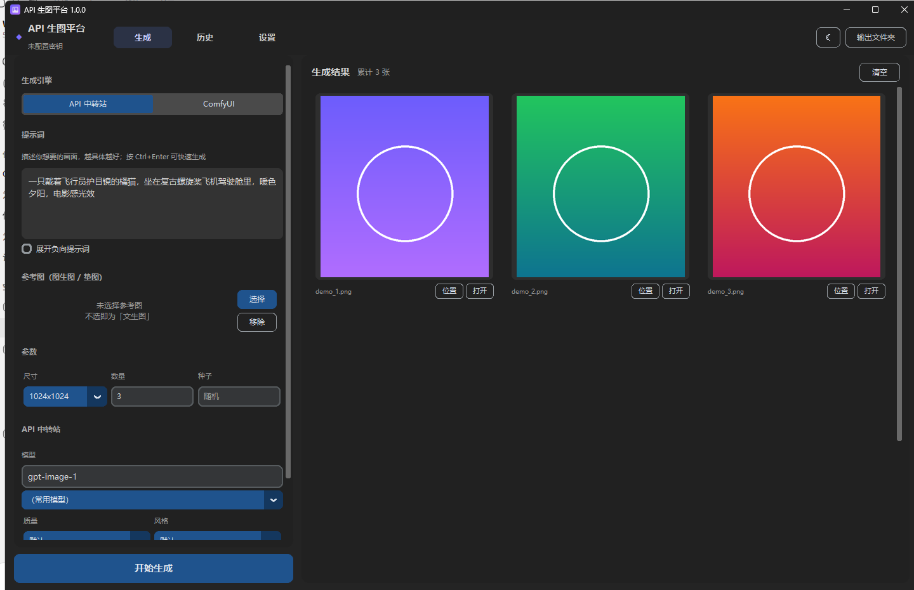
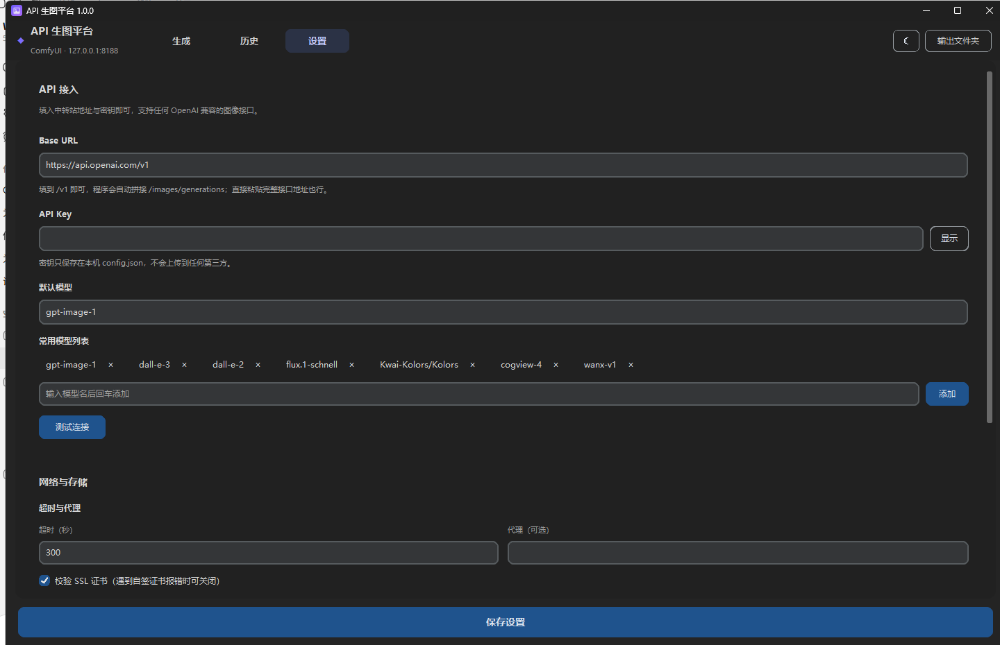
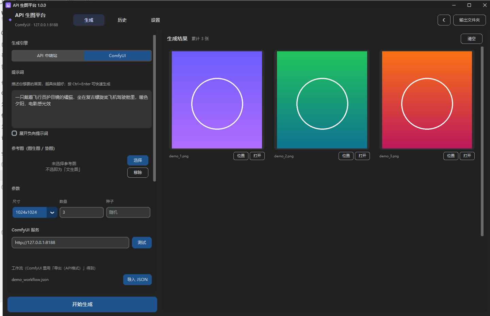

# API 生图平台

[](https://github.com/Elysiaum/api-image-studio/actions/workflows/ci.yml)
[](https://github.com/Elysiaum/api-image-studio/releases)
[](LICENSE)
[](#安装)
[](pyproject.toml)

> Windows 桌面生图工具。接入任意 OpenAI 兼容 API 中转站，或本地 / 远程 ComfyUI，
> 一站式完成文生图、图生图、批量生成与历史管理。

界面基于 tkinter（CustomTkinter），**不依赖浏览器内核**，Windows 11 上开箱即用。
所有请求由本机直接发往你自己配置的接口，不经过任何中间服务器。



## 功能特性

**两种生图后端，一键切换**

| | API 中转站 | ComfyUI |
|---|---|---|
| 适用 | OpenAI / DALL·E / FLUX / Kolors / 各类中转站 | 本地或远程 ComfyUI |
| 接入 | 填 Base URL + API Key + 模型名 | 填服务地址 + 导入工作流 JSON |
| 提示词 | 直接输入 | 自动映射到工作流节点 |
| 进度 | 按张显示 | WebSocket 实时采样进度 |

**通用能力**

- **文生图 / 图生图（垫图）** —— 选一张参考图即自动切换为图生图模式
- **批量生成** —— 一次最多 10 张，服务端不支持时自动降级为逐张请求
- **完整参数面板** —— 尺寸（含自定义）、数量、质量、风格、种子、返回格式
- **历史记录** —— 缩略图回看、一键复用提示词与参数、删除、清空
- **结果操作** —— 放大预览、用默认程序打开、在文件夹中显示、全部另存到桌面
- **深色 / 浅色主题**

**针对国内中转站的容错**

- Base URL 智能拼接：填到 `/v1` 即可，也接受完整接口地址
- 参数自动降级：服务端报错说不支持某字段时，自动移除后重试
- 返回结构兼容：`data[]` / `images[]` / 裸对象，`b64_json` / `url` / data-uri 都能解析

## 安装

### 方式一：安装包（推荐普通用户）

下载 `API生图平台_安装程序.exe` 双击安装即可。**目标电脑无需预装 Python。**

- 默认装到 `%LOCALAPPDATA%\Programs\API生图平台`，**不需要管理员权限**
- 自动创建桌面与开始菜单快捷方式
- 会登记到「应用和功能」，可正常卸载

### 方式二：从源码运行（推荐开发者）

需要 Python 3.10+，且**必须包含 tkinter**（python.org 官方安装包默认包含）。

```bat
:: 首次运行会自动建虚拟环境并装依赖
启动.bat
```

或手动：

```bat
py -3 -m venv .venv
.venv\Scripts\python.exe -m pip install -r requirements.txt
set PYTHONPATH=src
.venv\Scripts\python.exe -m api_image_studio
```

也可以安装成命令：

```bat
.venv\Scripts\python.exe -m pip install -e .
api-image-studio
```

## 快速开始

### 用 API 中转站



1. 打开程序，进「**设置**」页
2. 填 **Base URL**（填到 `/v1` 即可，例如 `https://api.openai.com/v1`）
3. 填 **API Key** 与**默认模型**（例如 `gpt-image-1`、`flux.1-schnell`）
4. 点「保存设置」，再点「测试连接」确认
5. 回「**生成**」页写提示词 → 「开始生成」

> 密钥只保存在本机，源码运行时在项目根目录的 `config.json`，安装后在 `%APPDATA%\API生图平台\config.json`。

### 用 ComfyUI



1. 先启动 ComfyUI（默认 `http://127.0.0.1:8188`）
2. 在程序的「生成引擎」里切到 **ComfyUI**，填服务地址，点「测试」
3. 在 ComfyUI 里搭好工作流，用 **「Workflow → Export (API)」** 导出 JSON
   > ⚠️ 必须是 **Export (API)** 格式。普通「Export」导出的是 `{"nodes": [...]}`，无法用于 API 调用。
4. 回到程序点「导入 JSON」
5. 程序会自动识别节点映射（正向/负向提示词、尺寸、种子、批量、参考图），一般无需手动调整
6. 点「开始生成」

## 目录结构

```
api-image-studio/
├── src/api_image_studio/       # 程序源码
│   ├── __init__.py             # 包元信息（版本号等）
│   ├── __main__.py             # 入口：python -m api_image_studio
│   ├── gui.py                  # 图形界面（CustomTkinter）
│   ├── assets/app.ico          # 程序图标
│   └── core/                   # 与界面无关的核心逻辑
│       ├── config.py           # 配置读写与路径解析
│       ├── history.py          # 历史记录与缩略图
│       ├── api_client.py       # OpenAI 兼容 API 客户端
│       └── comfy_client.py     # ComfyUI 客户端
├── tests/                      # 测试（自带模拟服务，不消耗 API 额度）
│   ├── test_core.py            # 后端与界面冒烟测试
│   ├── test_api_e2e.py         # 端到端：模拟中转站跑通全流程
│   └── test_comfy.py           # 端到端：模拟 ComfyUI（含 WebSocket）
├── build/                      # 打包脚本
│   ├── build.py                # 一键构建安装包
│   ├── installer.py            # 安装 / 卸载程序
│   └── make_icon.py            # 生成图标
├── docs/screenshots/           # 界面截图
├── 启动.bat                    # 源码运行（首次自动装依赖）
├── 调试启动.bat                # 带控制台，便于看报错
├── 安装依赖.bat                # 只装依赖
├── pyproject.toml
├── requirements.txt
└── requirements-dev.txt
```

## 开发

### 跑测试

三套测试都自带**本地模拟服务**，不消耗任何 API 额度：

```bat
.venv\Scripts\python.exe tests\test_core.py       # 后端 + 界面冒烟
.venv\Scripts\python.exe tests\test_api_e2e.py    # 模拟中转站，跑通文生图/图生图
.venv\Scripts\python.exe tests\test_comfy.py      # 模拟 ComfyUI（HTTP + WebSocket）
```

### 构建安装包

```bat
.venv\Scripts\python.exe -m pip install -r requirements-dev.txt
.venv\Scripts\python.exe build\build.py
```

产出 `dist/API生图平台_安装程序.exe`（单个文件）。构建脚本会自动清理中间产物。

需要额外的绿色版时加 `--all`：

```bat
.venv\Scripts\python.exe build\build.py --all
```

会额外产出 `dist/API生图平台/`（文件夹版）与 `dist/API生图平台_便携版.exe`（单文件版）。

## 常见问题

**Q：提示「没有可用的 Python」或缺少 tkinter？**
A：本工具需要带 tkinter 的 Python。从 [python.org](https://www.python.org/downloads/) 安装时，
请保留「tcl/tk and IDLE」勾选，并勾上「Add python.exe to PATH」。
注意部分精简版 / 嵌入式 Python 发行版不含 tkinter。

**Q：API 调用报错说某个参数不支持？**
A：程序会自动识别并移除不支持的字段后重试。如果仍失败，可在「高级选项」里把
「返回格式」设为「不指定」，并清空附加请求体。

**Q：图生图报错？**
A：不同中转站实现不同。在「高级选项 → 图生图调用方式」里换另一种试试
（`/images/edits` 与 `/images/generations + image 字段`）。

**Q：ComfyUI 提示工作流格式不对？**
A：必须用「Workflow → **Export (API)**」导出。普通 Export 出来的 `{"nodes": [...]}`
是给 ComfyUI 界面自己用的，不能提交给 API。

**Q：ComfyUI 没有实时进度？**
A：进度走 WebSocket。若连不上会自动退回轮询（仍能正常出图，只是进度不精确）。
请确认服务地址可达，且没有防火墙拦截 WebSocket。

**Q：图片生成到哪去了？**
A：源码运行时在项目 `output/` 目录；安装后在 `我的图片\API生图平台`。
可在「设置 → 图片保存目录」里修改，或点右上角「输出文件夹」直接打开。

## 参与贡献

欢迎提 Issue 与 PR！详细流程见 **[CONTRIBUTING.md](CONTRIBUTING.md)**。

快速说明：

1. 跑通 `tests/` 下的三套测试（自带模拟服务，不消耗 API 额度）
2. `src/api_image_studio/core/` 是核心层，**禁止依赖 tkinter**，保持与界面解耦
3. 新增功能请补上对应测试

遇到安全问题时，请**不要**开公开 Issue，按 **[SECURITY.md](SECURITY.md)** 的方式私下反馈。

## 许可

[MIT](LICENSE)

本项目仅提供工具，不对使用生成内容产生的任何后果负责。
请遵守你所使用的 API 服务商与模型的使用条款。
